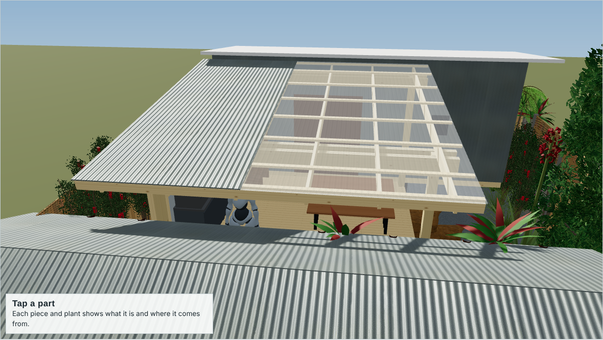
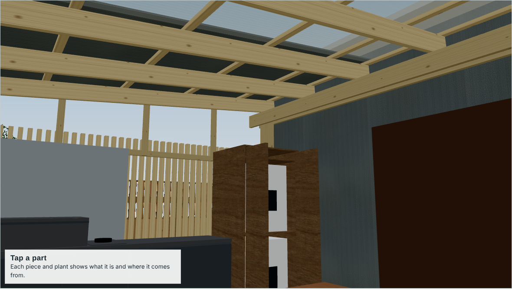
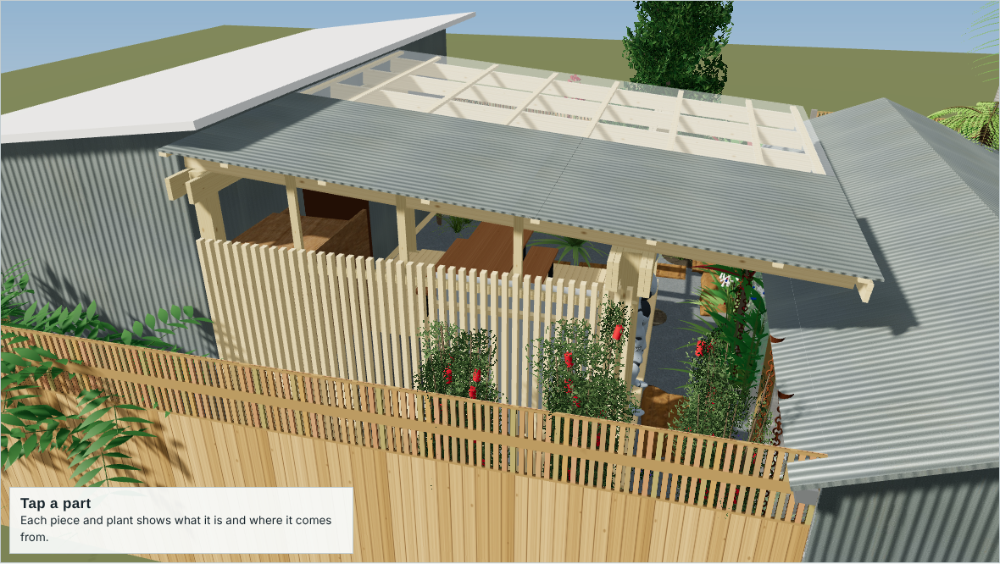
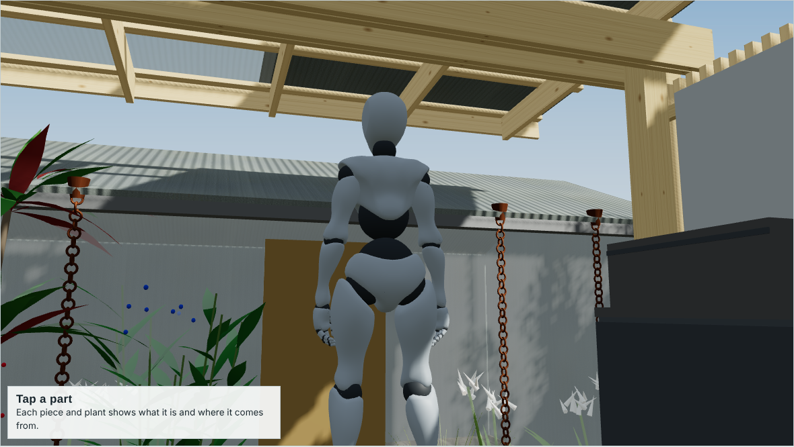

# Prince Street deck and awning: for review

A treated-pine deck (4.8 × 4.0 m) with a 5° skillion awning between a trailer studio and a shed, plus the outdoor kitchen, laundry and fence-end screen. This is a concept for a carpenter's feedback before drawings and ordering. **The structural numbers are preliminary checks, not an engineer's design.**

- **3D model:** open https://tradearts.github.io/prince-street-deck-awning/ (the `index.html` in this repo). Drag to orbit, use the view buttons, and tap any part to see its size, quantity, fixing notes and where it comes from.
- **The page** runs top to bottom: 3D model, engineering notes, build plans (framing plan, roof framing plan, section, screen elevation), materials, then the landscape.
- **Spec and parts list:** [SPEC.md](SPEC.md)
- **Images:** the `images/` folder

| | |
|---|---|
|  |  |
|  |  |

## What I'd like feedback on

1. **Posts and footings.** Four 150×150 H4 posts at the deck corners. The spec lists them concreted 900 deep, and also lists Pryda High Wind post anchors. Which would you do: in-ground posts or posts on stirrups above concrete?
2. **Beams.** B1 is 2/190×45 on the studio side. B2 is 4/240×45 (two plies each side of the posts) at the shed-side deck edge. Do the ply arrangement and bolting look right?
3. **Rafters.** 190×45 MGP10 at 930 centres, 3.76 m back span plus a 1.6 m cantilever toward the shed, with tie-downs to both beams. Is that comfortable?
4. **Deck framing.** Bearers on three lines, with one-piece 3 960 joists sitting on top at about 445 centres and the decking overhanging 20 to hide the joist ends. Any issues with the edge joists stopping at the posts?
5. **Vertical screen.** The slats fix to two rails outside the posts. The bottom rail screws into the edge joist and the top rail hangs from the edge rafter at three points. Would you do it differently?
6. **Roof sheets.** Clear corrugated poly plus leftover Zincalume at the BBQ end, lapped over a purlin, at 5° (the minimum for both). Any concerns about the laps or the fall?
7. **Order of work and anything missing:** fixings, flashings to the studio, bracing.

Please leave comments as GitHub issues, or mark up a screenshot.

## Viewing

The model needs to be served over http, not opened from a file, because browsers block its textures from a file. On GitHub Pages it just works. To run it locally, clone the repo and run `python3 -m http.server` in the repo folder, then open http://localhost:8000.
